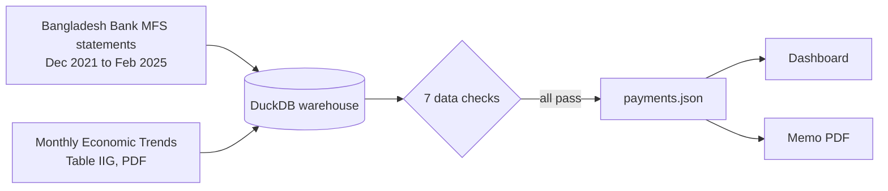

# Who wins digital payments in Bangladesh

**The question.** Mobile financial services (bKash, Nagad, Rocket and others) brought hundreds of millions of
Bangladeshis into digital money. Who is winning digital payments now, and what should an MFS do next?

**The answer.** MFS still owns the mass market, but it is a cash rail, and the growth in payments has moved to
bank apps. An MFS that wants to keep winning has to turn its cash rail into a payments network before bank apps
reach its customers: make paying a merchant cheaper than cashing out, capture salary and remittance at source,
and add the banking its customers will otherwise get from a bank app.

The argument is in the [four-page memo](memo/strategy_memo.pdf); the evidence is in the
[live dashboard](https://zubayerojhor.github.io/bd-digital-payments/). All data is Bangladesh Bank's.

## What the data says

| | |
|---|---|
| Internet banking value | Tk 0.18 lakh crore in FY2014-15, Tk 3.97 in FY2022-23, Tk 16.45 in FY2025-26 (4.1x in three years) |
| MFS value | Tk 1.42 lakh crore in FY2014-15, Tk 12.17 in FY2022-23, Tk 21.56 in FY2025-26 (1.8x in three years) |
| Cash in plus cash out, share of MFS value | 58.5% (Mar 2022 to Feb 2023), 60.6% (Mar 2024 to Feb 2025) |
| Merchant payments, share of MFS value | 3.5% to 4.6%, up 124% in two years; cash-out up 92% |
| Internet banking customers | 11.4m in FY2024-25, 22.7m in FY2025-26; average payment down from Tk 78,372 (FY2023-24) to Tk 48,466 |
| MFS providers, Apr to Jun 2026 | bKash about 67% of value, Nagad about 19%, Rocket about 14% (TBS, from Bangladesh Bank data) |

**A data warning.** Nagad did not report to Bangladesh Bank from March 2025 to February 2026. MFS agents fall 23%
in March 2025 and rise 36% in March 2026. Growth across those months mixes market change with a reporting change;
the pipeline flags them and the analysis compares like with like.

## How it is built



- **Getting the data.** Bangladesh Bank's site sits behind a JavaScript bot check, so the statements are read
  with a headless browser, one month at a time, and the PDFs are downloaded the same way. Product detail stops in
  February 2025: later months return "No data found".
- **Parsing.** Table IIG runs across several facing pages; two issues use different column layouts, and both are
  handled. Rows on the label page and the MFS page must line up one to one, or the parser stops.

| Check | Result |
|---|---|
| Months reported on two statement pages agree | 0 disagreements |
| MFS products add up to the total | within 0.55% (published lines are rounded) |
| The statement and Monthly Economic Trends agree on MFS value | 75% of months within 0.1%; largest gap 3.5% |
| Overlapping months agree across report issues | no revisions |
| Financial-year totals equal the sum of their months | exact |
| No missing months | none |
| The Nagad reporting gap is located | agents -23% in Mar 2025, +36% in Mar 2026 |

## Run it

```bash
pip install -e ".[dev]"
playwright install chromium
python -m payments            # fetch (cached in data/raw), build, check, export dashboard/data/payments.json
pytest -q
python scripts/screenshots.py
python scripts/make_memo.py
```

## Sources

- Bangladesh Bank, [Mobile Financial Services statements](https://www.bb.org.bd/en/index.php/financialactivity/mfsdata) and [Monthly Economic Trends](https://www.bb.org.bd/pub/monthly/econtrds/etaug26.pdf), Table IIG.
- Nagad's reporting gap: [The Financial Express](https://thefinancialexpress.com.bd/economy/bangladesh/mfs-growth-slows-amid-data-gaps-dip-in-remittances), [BSS](https://www.bssnews.net/business/391553).
- Provider shares: [The Business Standard](https://www.tbsnews.net/economy/banking/dutch-bangla-brac-bank-lead-digital-transactions-bkash-dominates-mfs-1599996).

This is an analysis of public data, not investment advice.

Built by Md. Zubayer with AI pair-programming (Claude). MIT licence.
